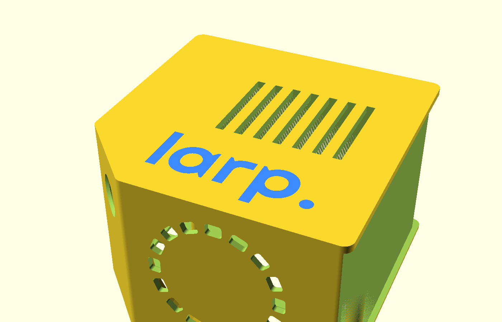
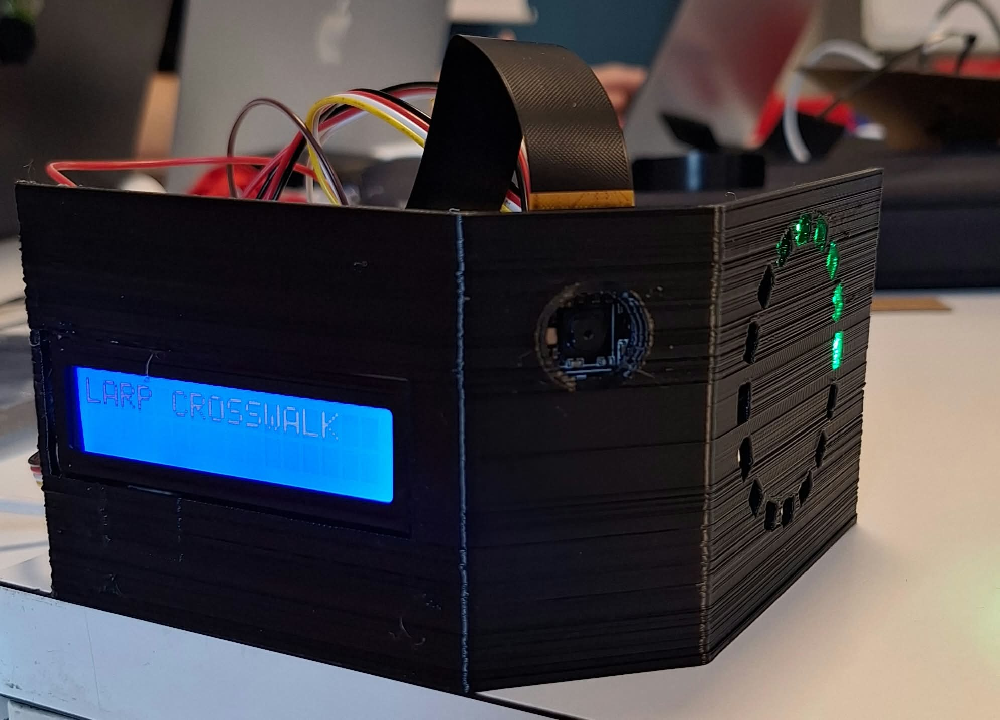
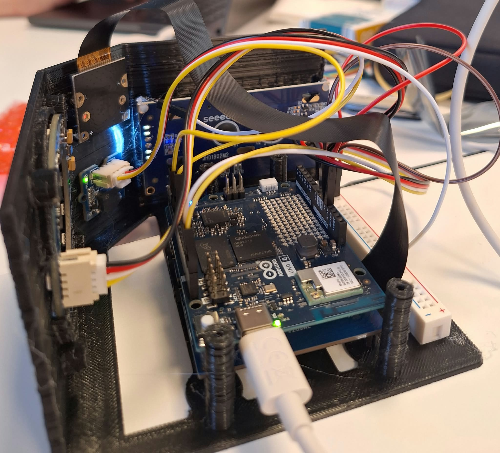

# larp

Smart crosswalk nodes and a network dashboard, built for hackTurin 2026.

A larp node watches a crosswalk with a camera and classifies what it sees directly on the device: cars, motorcycles, bicycles and pedestrians. It warns people on the spot, with a light ring and an LCD plus buzzer, and reports only counts and metadata to the network. No frame ever leaves the device. A dashboard turns those counts into a view of the whole network, showing which intersections are up, what passes through each one, and which hours look unusual enough to deserve a human check.


_The dashboard running on simulated data._

## How it works

```
 camera ──► object detection (on device) ──► ring / LCD / buzzer   (immediate warnings)
                      │
                      └──► local SQLite counts ──► hourly HTTP batches ──► dashboard
```

1. The node captures frames from a CSI camera and runs an object detection model on the Arduino UNO Q itself.
2. A person above 75% confidence turns the LED ring solid red, a person at or below 75% turns it solid yellow, and otherwise it rotates green. A detected car, motorcycle or bicycle shows `APPROACHING` on the LCD and sounds a short beep.
3. A lightweight tracker counts each object once. Counts are stored locally and sent as hourly batches to a configurable HTTP endpoint, with offline retries.
4. The dashboard aggregates the counts per intersection and flags hours that depart from the intersection's own history, so an operator can confirm them or mark them as sensor errors.

## Repository layout

| Folder                                     | Contents                                                                                                                                                                                                                                          |
| ------------------------------------------ | ------------------------------------------------------------------------------------------------------------------------------------------------------------------------------------------------------------------------------------------------- |
| [`arduino_dashboard/`](arduino_dashboard/) | The software side. `larp_crosswalk/` is the Arduino App Lab application that runs on the node (Python vision pipeline, sketch for the ring, buzzer and LCD, telemetry). `dashboard/` is the network dashboard (React, Vite, TypeScript, Leaflet). |
| [`openscad/`](openscad/)                   | The hardware side: a parametric, 3D-printable enclosure in OpenSCAD with STL files, check renders, assembly notes and an exploded-view video.                                                                                                     |
| [`yolo_train/`](yolo_train/)               | Training, evaluation and ONNX export of the detection models (YOLO11n and YOLOX-Nano) on a four-class COCO subset at 320×320, ready for import into Edge Impulse.                                                                                 |

Each folder has its own README with the details.

## Hardware

- Arduino UNO Q with UNO Media Carrier
- Sony IMX219 8 MP camera (CSI)
- Grove 16×2 RGB LCD
- Grove RGB LED Ring, 16 × WS2813 Mini
- Grove Passive Buzzer

## The enclosure

The node lives in a 3D-printed enclosure designed in OpenSCAD. The camera sits on the chamfered front face, the LCD on the left wall and the LED ring on the right wall. The back is open for USB-C and cabling, and a screwless lid closes the top, engraved with the project logo.

| CAD render | Printed prototype, powered on |
|---|---|
|  |  |

*Left: the lid with the engraved logo and the LED ring slots in the side wall. Right: the printed prototype running, with the LCD in its idle state and the LED ring rotating green.*



*The same prototype with the lid removed and the electronics mounted.*

## Getting started

### Dashboard

```bash
cd arduino_dashboard/dashboard
npm install
npm run dev        # http://localhost:5173
```

The dashboard shows six intersections along Corso Bolzano in Turin. Since there are no real detection logs yet, every count comes from a deterministic simulation, and the interface labels it as such. Real data plugs in through a single `TrafficSource` interface, described in the [dashboard README](arduino_dashboard/dashboard/README.md).

### Node

Open `arduino_dashboard/larp_crosswalk/` in Arduino App Lab and press **Run**. Wiring, camera settings, warning behavior and the telemetry contract are covered in the [node README](arduino_dashboard/larp_crosswalk/README.md) and in [TELEMETRY.md](arduino_dashboard/larp_crosswalk/TELEMETRY.md).

### Enclosure

The STL files are in [`openscad/smart-camera/stl/`](openscad/smart-camera/stl/). To change the design, edit `openscad/smart-camera/smart_camera_enclosure.scad`. Dimensions, fasteners, print settings and the list of items to check on the physical parts are in the [enclosure README](openscad/smart-camera/README.md).

### Model training

```bash
cd yolo_train
uv sync --locked
uv run python scripts/yolo11/train_yolo11.py --prepare-data
```

This downloads the dataset, trains YOLO11n and exports the best checkpoint to ONNX. The [training README](yolo_train/README.md) also covers YOLOX-Nano, evaluation and calibration for INT8 quantization.

## Current status and limitations

- The dashboard runs on simulated data. The HTTP adapter is a documented stub and no gateway is implemented in this repository.
- The detection metrics in `yolo_train` (YOLO11n: 46.1% mAP50, 26.6% mAP50-95) were measured on a held-out part of COCO, not on footage from a real crossing. Accuracy on the real camera has still to be measured.
- Counts are estimates of passages, not distinct individuals. See [TELEMETRY.md](arduino_dashboard/larp_crosswalk/TELEMETRY.md) for the tracking limits.
- The enclosure has not been verified mechanically, and several dimensions, such as the stack gap between the carrier and the UNO Q, are estimates listed in its README.

## Licenses

The repository root is licensed under the [GNU GPL-3.0](LICENSE). Some components carry their own license:

| Component                                                                       | License                                                                    |
| ------------------------------------------------------------------------------- | -------------------------------------------------------------------------- |
| [`arduino_dashboard/larp_crosswalk/`](arduino_dashboard/larp_crosswalk/LICENSE) | MIT, with Arduino's MPL-2.0 notice kept on the files derived from it       |
| [`openscad/`](openscad/LICENSE)                                                 | GNU AGPL-3.0                                                               |
| [`yolo_train/`](yolo_train/LICENSE)                                             | GNU AGPL-3.0 (the license of the Ultralytics library); YOLOX is Apache-2.0 |
