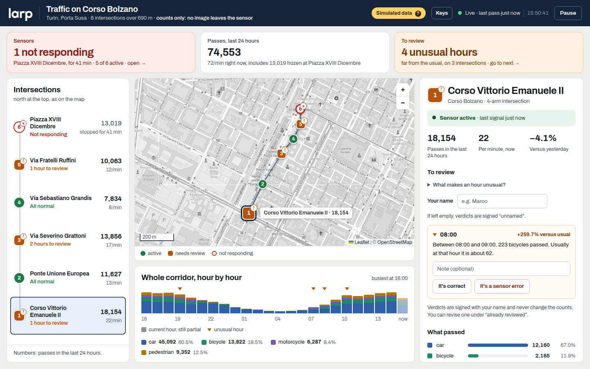

# larp

Smart crosswalk nodes and a network dashboard, built for hackTurin 2026.

A **larp** node watches a crosswalk with a camera, classifies what it sees on the
device (car, bicycle, motorcycle, pedestrian) and warns people on the spot: a
light ring turns red or yellow when a pedestrian is detected, and an LCD plus a
buzzer warn when a vehicle is approaching. The node sends **counts and metadata
only, never a frame**, so the network knows how much passes through each
intersection without anyone being filmed.

The dashboard turns those counts into a live view of the network: which
intersections are up, what is passing through each one, and which hours look
unusual enough to be worth a human check.



*The dashboard running on simulated data. The sixth node is silent, and the first one has an unusual hour waiting for a verdict.*

## Repository layout

| Folder | What it is |
|---|---|
| [`larp_crosswalk/`](larp_crosswalk/) | The node: an Arduino UNO Q App Lab app (Python vision pipeline, sketch for the LED ring, buzzer and LCD, local statistics database, telemetry sync). |
| [`dashboard/`](dashboard/) | The network dashboard: React + Vite + TypeScript, Leaflet over OpenStreetMap. |

## Hardware

Arduino UNO Q, UNO Media Carrier, Sony IMX219 camera, Grove 16x2 RGB LCD,
16-LED WS2813 ring, passive buzzer. Wiring and behavior are in the
[node README](larp_crosswalk/README.md).

## Run the dashboard

```bash
cd dashboard
npm install
npm run dev        # http://localhost:5173
```

The dashboard shows six intersections along Corso Bolzano in Turin, anchored to
real OpenStreetMap nodes. There are no real detection logs yet, so every count is
a deterministic simulation and the interface says so ("Simulated data"). Details
and the path to a real feed are in the [dashboard README](dashboard/README.md).

## Run the node

Open `larp_crosswalk/` in Arduino App Lab and press **Run**. See the
[node README](larp_crosswalk/README.md) for the camera settings, the effects
and the telemetry contract ([TELEMETRY.md](larp_crosswalk/TELEMETRY.md)).

## License

The node app is released under the MIT license, see
[`larp_crosswalk/LICENSE`](larp_crosswalk/LICENSE).
